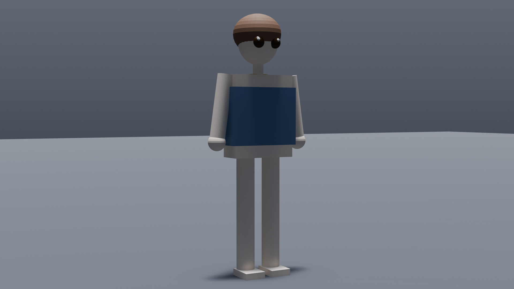

<h1 align="center">Blender MCP AI</h1>

<p align="center">
  
</p>
<p align="center">
  <strong>Control Blender with AI through the Model Context Protocol</strong>
</p>

<p align="center">
  <a href="https://github.com/harveyxiacn/blender-mcp-ai/actions"></a>
  
  
  
  <a href="LICENSE"></a>
  <a href="https://github.com/harveyxiacn/blender-mcp-ai/issues"></a>
  <a href="https://github.com/harveyxiacn/blender-mcp-ai/discussions"></a>
  <a href="https://discord.gg/rurjWE45"></a>
</p>

<p align="center">
  <a href="#quick-start">Quick Start</a> •
  <a href="docs/en/ARCHITECTURE.md">Architecture</a> •
  <a href="docs/en/API_REFERENCE.md">API Reference</a> •
  <a href="docs/en/CONTRIBUTING.md">Contributing</a> •
  <a href="https://github.com/harveyxiacn/blender-mcp-ai/discussions">Discussions</a> •
  <a href="#中文">中文</a>
</p>

---

> [!IMPORTANT]
> **This project is not affiliated with any other Blender MCP project.**
> It is an independent, original codebase — not a fork of, and sharing no code
> with, anything else. In particular it is unrelated to
> [`ahujasid/mcp-for-blender`](https://github.com/ahujasid/mcp-for-blender)
> (formerly published on PyPI as `blender-mcp`). The `blender-mcp` package on
> PyPI belongs to *that* project: installing it does **not** install this
> software. Install this project by cloning this repository — see
> [Quick Start](#quick-start).

> **Provenance:** The overall shape — an MCP server talking to a Blender addon
> over a local socket — is the standard approach for this category of tool and
> is shared by other Blender MCP projects, so the architectures look similar.
> This repository is **not a fork**, and the implementation here is independent.

## Overview

**Blender MCP AI** is an open-source [Model Context Protocol](https://modelcontextprotocol.io/) server that lets AI assistants control [Blender](https://www.blender.org/) through natural language. It works with any MCP-compatible client — **Cursor**, **Windsurf**, **Claude Desktop**, and more.

The project consists of two components:
- **MCP Server** (`src/blender_mcp/`) — a FastMCP server exposing Blender operations as MCP tools
- **Blender Addon** (`addon/blender_mcp_addon/`) — a Blender plugin that receives commands over TCP and executes them via Blender's Python API

```
AI Client (Cursor / Windsurf / Claude Desktop)
    ↓  MCP protocol (stdio or HTTP)
Blender MCP Server (Python, FastMCP)
    ↓  TCP JSON messages (localhost:9876)
Blender Addon (runs inside Blender)
    ↓  Blender Python API (bpy)
Blender
```

## Gallery

> Generated entirely through natural-language AI commands via Blender MCP AI — no manual Blender interaction.



*A character built end-to-end by the agent — body template, hair, clothing and accessory — then lit and rendered at 1920×1080 through the MCP tools. It is a deliberately simple primitive-based blockout: the point is the round trip, not the polish.*

The point of this project isn't the polish of any single render — it's the **agent ↔ Blender pipeline**: 380 tools, dynamic skill loading to keep the model's context lean, and viewport/render snapshots that let the model review its own work and iterate.

## Key Features

- **380 MCP tools** across 56 modules — modeling, materials, animation, rendering, rigging, and more
- **Smart skill loading** — default `skill` profile starts with 38 tools; 12 skill groups activate on demand to keep AI context lean
- **6 profiles** — from `minimal` (35 tools) to `full` (377 tools)
- **Visual feedback** — `blender_snapshot_viewport` and `blender_snapshot_render_preview` for multimodal AI review loops
- **Checkpoint system** — named save/restore points before risky operations
- **Style system** — 8 rendering style presets from Pixel Art to AAA
- **67 procedural materials** — metals, woods, stones, fabrics, nature, skin, effects, toon
- **Quality audit** — topology, UV, and performance validation
- **Blender 4.x / 5.x** compatible
- **Multi-IDE support** — Cursor, Windsurf, Claude Desktop, and any MCP client

## Quick Start

### Prerequisites

- **Python 3.10+**
- **Blender 4.0+**
- **[uv](https://docs.astral.sh/uv/)**
- An MCP-compatible client

### Install & Run

> There is no PyPI release yet. Install from source — `pip install blender-mcp`
> would install an unrelated third-party package (see the notice at the top).

```bash
git clone https://github.com/harveyxiacn/blender-mcp-ai.git
cd blender-mcp-ai
uv sync

# Build the Blender addon
python build_addon.py

# Start the MCP server
uv run blender-mcp-ai
```

### Set Up Blender

1. Open Blender → `Edit` → `Preferences` → `Add-ons` → `Install...`
2. Select `dist/blender_mcp_addon.zip`
3. Enable **Blender MCP**
4. Open the **MCP** panel in the 3D View sidebar

### Configure Your IDE

Add to your MCP client config:

```json
{
  "mcpServers": {
    "blender": {
      "command": "uv",
      "args": ["run", "--directory", "/path/to/blender-mcp-ai", "blender-mcp-ai"]
    }
  }
}
```

## Tool Profiles

| Profile | Tools | Use Case |
|---------|-------|----------|
| `minimal` | 35 | Core scene/object/utility/export only |
| `skill` | 38 | **Default** — core + on-demand skill loading |
| `focused` | 124 | Curated workflow set |
| `standard` | 186 | Broader daily-use coverage |
| `extended` | 215 | Adds physics & batch operations |
| `full` | 377 | Everything |

## Skill System

With the default `skill` profile, only core tools load at startup. AI activates additional groups on demand:

```
blender_list_skills         → see all 12 available skill groups
blender_activate_skill      → load a group's tools dynamically
blender_deactivate_skill    → unload to free AI context
```

Skills include: `modeling`, `materials`, `style`, `character`, `animation`, `scene_setup`, `automation`, `physics`, `batch_assets`, `advanced_3d`, `sport_character`, `training`.

## Documentation

All documentation is available in **English** and **中文 (Chinese)**.

| Document | English | 中文 |
|----------|---------|------|
| Quick Start | [QUICKSTART](docs/en/QUICKSTART.md) | [快速开始](docs/zh/QUICKSTART.md) |
| Installation | [INSTALLATION](docs/en/INSTALLATION.md) | [安装指南](docs/zh/INSTALLATION.md) |
| Architecture | [ARCHITECTURE](docs/en/ARCHITECTURE.md) | [架构设计](docs/zh/ARCHITECTURE.md) |
| API Reference | [API_REFERENCE](docs/en/API_REFERENCE.md) | [API 参考](docs/zh/API_REFERENCE.md) |
| Skill System | [MCP_SKILL_SYSTEM_GUIDE](docs/en/MCP_SKILL_SYSTEM_GUIDE.md) | [Skill 系统指南](docs/zh/MCP_SKILL_SYSTEM_GUIDE.md) |
| Tutorials | [TUTORIALS](docs/en/TUTORIALS.md) | [教程](docs/zh/TUTORIALS.md) |
| Contributing | [CONTRIBUTING](docs/en/CONTRIBUTING.md) | [贡献指南](docs/zh/CONTRIBUTING.md) |
| Changelog | [CHANGELOG](docs/en/CHANGELOG.md) | [更新日志](docs/zh/CHANGELOG.md) |
| Roadmap | [ROADMAP](docs/en/ROADMAP.md) | [路线图](docs/zh/ROADMAP.md) |
| Security | [SECURITY](SECURITY.md) | [安全策略](docs/zh/SECURITY.md) |
| Code of Conduct | [CODE_OF_CONDUCT](CODE_OF_CONDUCT.md) | [行为准则](docs/zh/CODE_OF_CONDUCT.md) |

## Community

- **[Discord](https://discord.gg/rurjWE45)** — live chat, help, and show & tell
- **[GitHub Discussions](https://github.com/harveyxiacn/blender-mcp-ai/discussions)** — questions, ideas, long-form discussion
- **[Issues](https://github.com/harveyxiacn/blender-mcp-ai/issues)** — bug reports and feature requests
- **[Contributing Guide](docs/en/CONTRIBUTING.md)** — how to add tools, fix bugs, improve docs

## Contributing

We welcome contributions! Please see [CONTRIBUTING.md](docs/en/CONTRIBUTING.md) for guidelines.

1. Fork the repo & create a feature branch
2. Install dev dependencies: `uv sync --all-extras`
3. Make changes and add tests
4. Run checks: `pytest && ruff check src/ && black --check src/`
5. Submit a pull request

## Security

For security concerns, please see [SECURITY.md](SECURITY.md). Do **not** open a public issue for security vulnerabilities.

## Known Caveats

- If `.venv` breaks after copying the repo to another machine, delete `.venv` and re-run `uv sync`

## License

[MIT](LICENSE) — Copyright (c) 2026 Harvey Xia

---

## 中文

> [!IMPORTANT]
> **本项目与其他任何同名 Blender MCP 项目均无关联。**
> 这是一套独立、原创的代码库，不是任何项目的 fork，也不共用任何代码。特别地，本项目与
> [`ahujasid/mcp-for-blender`](https://github.com/ahujasid/mcp-for-blender)（其旧版在 PyPI 上
> 叫 `blender-mcp`）毫无关系。PyPI 上的 `blender-mcp` 属于**那个**项目，安装它**不会**安装本软件。
> 安装本项目请克隆本仓库，见[快速开始](#快速开始)。

> **来源说明：** 「MCP 服务器 + Blender 插件、走本地 socket」这个整体形态是本类工具的通用做法，
> 其他 Blender MCP 项目也采用类似结构，因此架构层面看起来会相似。本仓库**不是 fork**，
> 实现为独立完成。

### 概述

**Blender MCP AI** 是一个开源的 [Model Context Protocol](https://modelcontextprotocol.io/) 服务器，让 AI 助手可以通过自然语言控制 [Blender](https://www.blender.org/)。支持 **Cursor**、**Windsurf**、**Claude Desktop** 等任意 MCP 兼容客户端。

### 展示

> 以下渲染完全通过自然语言 AI 命令生成，无需手动操作 Blender。


*一个由智能体端到端生成的角色 —— 体型模板、头发、服装、配饰全部由 MCP 工具创建，再经打光与 1920×1080 渲染。它是刻意简化的图元搭建，重点在完整回路，而非精细度。* 本项目的价值不在单张渲染的精细度，而在 **agent ↔ Blender 管线**：380 个工具、动态技能加载以精简上下文、以及让模型自审自迭代的视口/渲染截图。

### 核心特性

- **380 个 MCP 工具**，覆盖建模、材质、动画、渲染等全流程
- **智能工具加载** — 默认 `skill` 配置仅加载 38 个工具，12 个技能组按需激活
- **6 种配置方案** — 从 `minimal`（35 个工具）到 `full`（377 个工具）
- **视觉反馈** — 视口截图 + 渲染预览，支持多模态 AI 审查循环
- **检查点系统** — 高风险操作前的命名存档/还原点
- **风格系统** — 8 种渲染风格预设（像素风到 3A 级）
- **67 种程序化材质** — 金属、木材、石材、布料、自然、皮肤、特效、卡通
- **质量审计** — 拓扑、UV、性能验证
- **兼容 Blender 4.x / 5.x**

### 快速开始

```bash
git clone https://github.com/harveyxiacn/blender-mcp-ai.git
cd blender-mcp-ai
uv sync

# 打包 Blender 插件
python build_addon.py

# 启动 MCP 服务器
uv run blender-mcp-ai
```

> 目前尚未发布到 PyPI。请从源码安装 —— `pip install blender-mcp`
> 装到的是**另一个**无关的第三方包（见顶部说明）。

然后在 Blender 中：

1. `编辑` → `偏好设置` → `插件` → `安装...`
2. 选择 `dist/blender_mcp_addon.zip`
3. 启用 **Blender MCP**
4. 在 3D 视图侧边栏打开 **MCP** 面板

IDE 配置：

```json
{
  "mcpServers": {
    "blender": {
      "command": "uv",
      "args": ["run", "--directory", "/path/to/blender-mcp-ai", "blender-mcp-ai"]
    }
  }
}
```

### 社区

- **[Discord](https://discord.gg/rurjWE45)** — 实时交流、使用帮助、作品展示
- **[GitHub Discussions](https://github.com/harveyxiacn/blender-mcp-ai/discussions)** — 提问、讨论、展示作品
- **[Issues](https://github.com/harveyxiacn/blender-mcp-ai/issues)** — 问题反馈与功能建议

### 文档

所有文档均提供 **English** 和 **中文** 版本，详见上方[文档表格](#documentation)。

### 系统要求

- Python 3.10+
- Blender 4.0+
- 任意兼容 MCP 的客户端

### 许可证

[MIT](LICENSE) — Copyright (c) 2026 Harvey Xia
